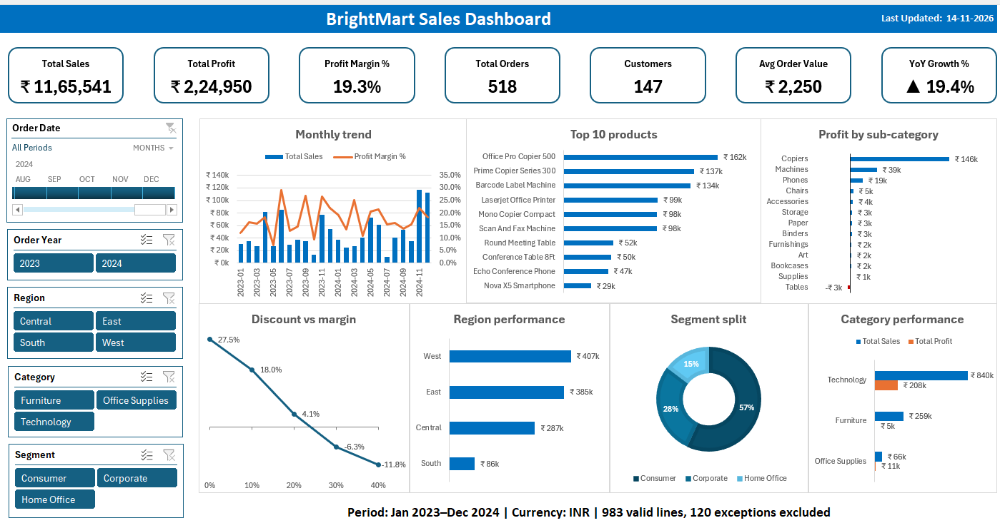
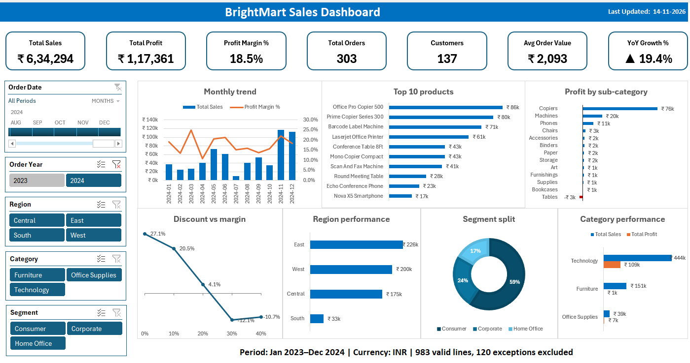
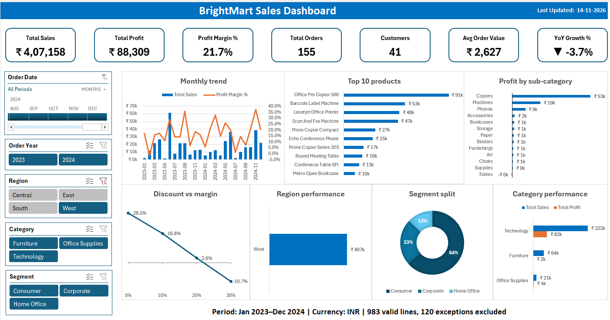

# BrightMart Sales MIS Dashboard (Excel)

An interactive Excel MIS dashboard built from messy sales data for a fictional retail company, **BrightMart Retail Pvt. Ltd.** The project covers the full MIS workflow: cleaning raw data with Power Query, building KPIs with DAX, creating an interactive dashboard, and writing business insights for management.



## Business problem

The Sales Head wants one report that answers:

1. Which products and categories sell the most?
2. Which regions generate the most revenue and profit?
3. How do sales change month by month?
4. Where is the company losing money?
5. Who are the top customers and segments?
6. Does discounting affect profit?

## Dataset

- Synthetic, Superstore-style sales data (orders, customers, products, region, sales, quantity, discount, profit), **generated for practice**. BrightMart Retail is a fictional company.
- Period: Jan 2023 – Dec 2024.
- The raw file was deliberately messy, to practise real-world cleaning (see below).

## Tools and skills used

| Area | What I used |
|---|---|
| Data cleaning | Power Query (M), custom columns, merge with lookup table, data quality flags |
| Calculations | SUMIFS, COUNTIFS, XLOOKUP, UNIQUE, SORT, SORTBY, LET, IFERROR, GETPIVOTDATA |
| Modelling | Excel Data Model, DAX measures (SUM, DIVIDE, DISTINCTCOUNT, CALCULATE) |
| Reporting | PivotTables, PivotCharts, slicers, timeline, combo charts |
| Design | Conditional formatting, custom number formats, KPI cards, sheet protection |

## Data cleaning

Raw data problems found and fixed in Power Query:

| Problem | Fix |
|---|---|
| Title rows on top, "Grand Total" row at bottom, blank rows | Removed top/bottom rows and blank rows |
| 40 exact duplicate rows | Removed duplicates using Row ID |
| Dates stored as text in 3 formats | Converted with Change Type Using Locale |
| Sales as `$1,234.50`, Discount as `20%`, Quantity as `3 pcs` | Stripped symbols and converted to numbers |
| `N/A`, `NULL`, `-`, `?` in Profit | Replaced with null |
| Extra spaces, mixed case, typos (Tecnology, Furnitures...) | Trim, Clean, Capitalize, Replace Values |
| State abbreviations and misspellings | Merged with a lookup table |
| Postal codes that lost leading zeros | Text type with zero padding |
| Impossible values (negative sales, discount above 100%, ship date before order date) | Flagged, not silently deleted |

**Three-layer design:** `Sales_Staging` (everything cleaned, with a Data Quality Flag) → `Sales_Clean` (valid rows, used for analysis) and `Sales_Exceptions` (rows needing review).

**Reconciliation:** 1,103 unique records = 983 valid + 120 exceptions.

| Exception reason | Rows |
|---|---|
| Missing Profit | 37 |
| Bad Quantity | 21 |
| Ship Date before Order Date | 21 |
| Missing Sales | 15 |
| Missing Order Date | 8 |
| Quantity outlier | 6 |
| Negative Sales | 6 |
| Bad Discount | 4 |
| Profit outlier | 2 |

## Key metrics (full period)

| KPI | Value |
|---|---|
| Total Sales | ₹11,65,541 |
| Total Profit | ₹2,24,950 |
| Profit Margin | 19.3% |
| Total Orders | 518 |
| Customers | 147 |
| Average Order Value | ₹2,250 |
| YoY Sales Growth (2024 vs 2023) | +19.4% |

## Dashboard features

- 7 KPI cards that update with the filters (GETPIVOTDATA on a measure-only pivot)
- Slicers for Region, Category, Segment and Year, plus a date timeline, all connected to every pivot
- Monthly trend (sales + margin on a secondary axis), Top 10 products, profit by sub-category, discount vs margin, region, segment and category charts




## Key insights

1. **Heavy discounts destroy profit.** Margin is 27.5% at 0% discount, 4.1% at 20%, and negative from 30%. Lines sold at 30%+ discount are about 5% of sales and make a loss. *Action: require approval above 20%.*
2. **Furniture earns very little.** 22% of sales but about 2% of profit; it turns loss-making at 20% discount. Tables is the only loss-making sub-category. *Action: cap furniture discounts at 10%.*
3. **Central grew by discounting.** +56.7% sales growth but the lowest margin (13.3%), with an average discount of 18% against 6–7% elsewhere. *Action: review Central's discount policy.*
4. **Profit is concentrated.** Technology is 72% of sales and 92% of profit; Copiers alone give about 65% of total profit. *Action: protect Copier supply and pricing; develop other categories.*
5. **West and South are shrinking in value.** Orders rose but sales fell (West -3.7%, South -36.2%), so the average order value dropped. *Action: investigate smaller baskets; try bundles and upselling.*
6. **Margin is slipping.** Sales +19.4% but profit only +9.1%; margin fell from 20.2% to 18.5%. *Action: track margin monthly.*
7. **Year-end dependence is growing.** Nov–Dec was 24.8% of sales in 2023 and 36.3% in 2024. *Action: plan stock and staff early for Q4.*

> The data is synthetic, so these insights demonstrate the analysis method. With real data I would validate each finding with the business before acting on it.

## Repository structure

```
├── README.md
├── Messy raw data (starting point)
├── Final dashboard workbook
└── Dashboard images
```

## How to use

1. Download `BrightMart_Sales_MIS_Dashboard.xlsx` (Excel 365 or 2021 recommended for dynamic array formulas).
2. Click **Data → Refresh All** to rerun the Power Query cleaning.
3. Use the slicers on the **Dashboard** sheet to explore.

## Roadmap

- Add a proper Date table and `SAMEPERIODLASTYEAR` for time-intelligence measures
- Add a one-click refresh and PDF export macro
- Rebuild the dashboard in Power BI

## Author

**LAHU LAXMAN SHELAR**, aspiring MIS Executive / Data Analyst
[Email](mailto:shelar.lahu24@gmail.com)
